# PsiTerm

**An SSH terminal for the 1999 Psion Series 5mx, and now the netBook and
Series 7:** tmux, vim, htop and Claude Code on a palmtop, as a native EPOC app that looks and behaves
like the Psion's own programs. PsiTerm is part of a suite that brings the
5mx into 2026: see [The suite](#the-suite) for PsiMail (email and calendar),
PsiWeb (a web browser), PsiCast (screen sharing), PsiLinux, the PsiConnect
modem firmware and PsiProxy.

> **Beta - Expect bugs!** The apps are new and changing fast. They
> work well enough for daily SSH, tmux, Claude Code and email on a real 5mx,
> but things will break. Bug reports (a photo of the screen is perfect) are
> very welcome via [GitHub issues](https://github.com/danieledge/psiterm/issues).

[](https://github.com/danieledge/psiterm/raw/main/dist/PsiTerm.sis)
[](https://github.com/danieledge/psiterm/raw/main/dist/PsiMail.sis)
[](https://github.com/danieledge/psiterm/raw/main/dist/PsiWeb.sis)
[](https://buymeacoffee.com/danedge)

<p align="center">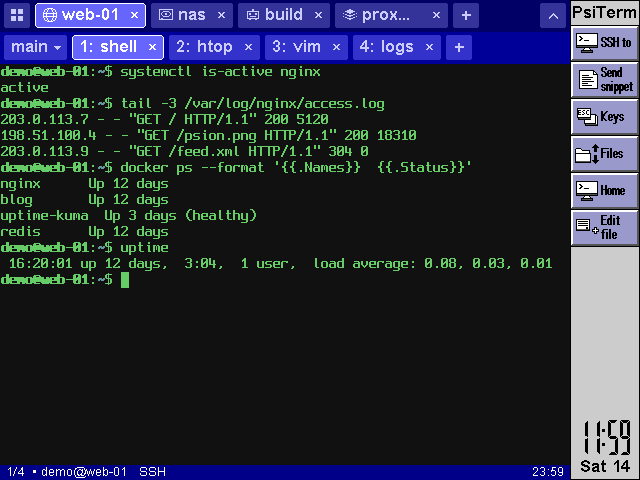</p>

PsiTerm 1.11. It shares one connection layer with the other apps
([psion-core](https://github.com/danieledge/psion-core)): a Wi-Fi modem on
the serial port (`ATDT host:port`) or the Psion's own dial-up TCP/IP. Modern
servers work: curve25519, Ed25519, ChaCha20-Poly1305 and TLS 1.3, all on the
Psion's ARM710.

## Contents

- [Screenshots](#screenshots)
- [What's new](#whats-new)
- [What it does](#what-it-does)
- [Installing](#installing)
- [Connecting](#connecting)
- [Updates](#updates)
- [Building from source](#building-from-source)
- [The suite](#the-suite)
- [Support](#support) · [Licence and credits](#licence-and-credits)

## Screenshots

PsiTerm 1.11 on the netBook (640x480, colour) and the Series 5mx (640x240,
16 greys), with the same demo servers. Taken in emulators. Tap or click one
to see it full size.

<table>
<tr><th>netBook</th><th>Series 5mx</th></tr>
<tr><td colspan="2"><b>Start view: Pinned, Recent and folders</b></td></tr>
<tr>
<td><a href="docs/screenshots/netbook-01-home.png">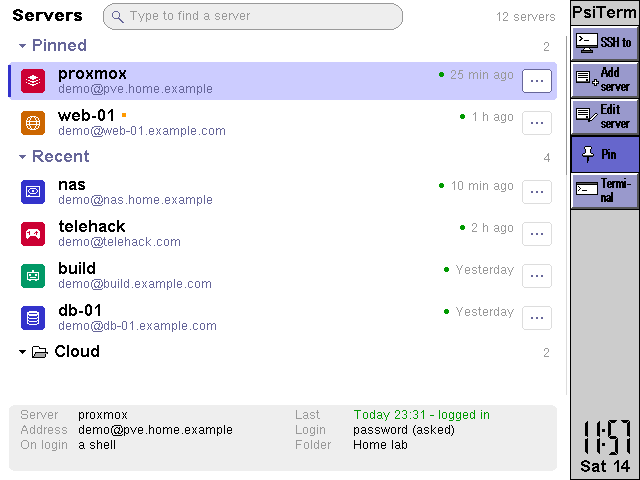</a></td>
<td><a href="docs/screenshots/5mx-01-home.png">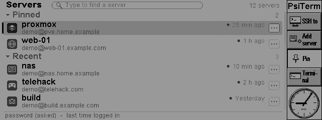</a></td>
</tr>
<tr><td colspan="2"><b>Type to find a server</b></td></tr>
<tr>
<td><a href="docs/screenshots/netbook-02-search.png">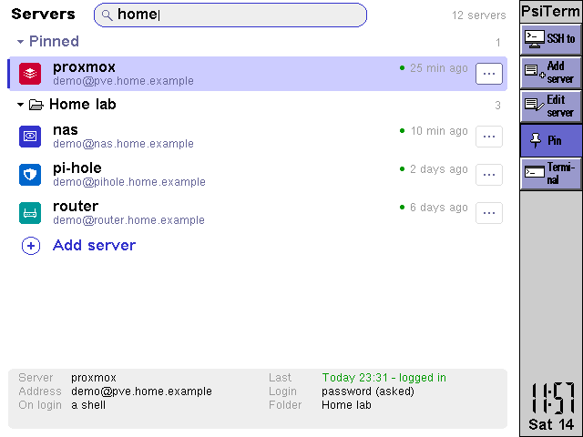</a></td>
<td><a href="docs/screenshots/5mx-02-search.png">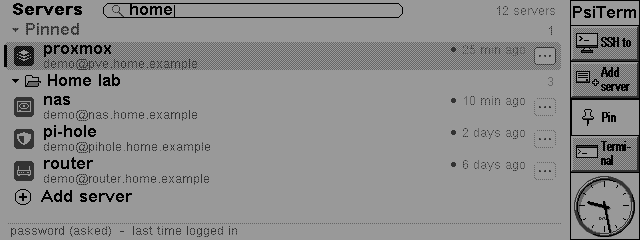</a></td>
</tr>
<tr><td colspan="2"><b>Folders for each group of servers</b></td></tr>
<tr>
<td><a href="docs/screenshots/netbook-03-folders.png">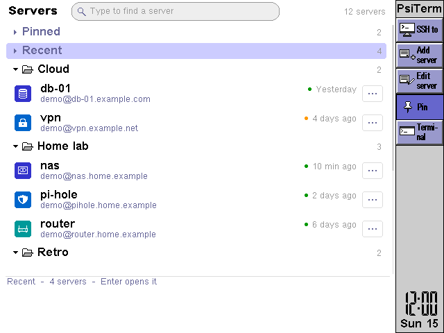</a></td>
<td><a href="docs/screenshots/5mx-03-folders.png">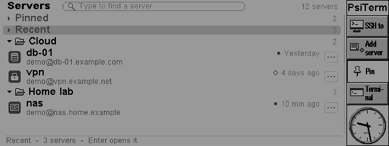</a></td>
</tr>
<tr><td colspan="2"><b>43 icons to choose from</b></td></tr>
<tr>
<td><a href="docs/screenshots/netbook-04-icons.png">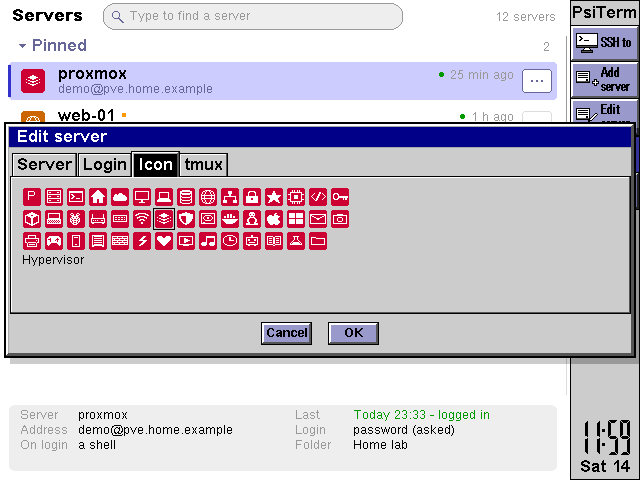</a></td>
<td><a href="docs/screenshots/5mx-04-icons.png">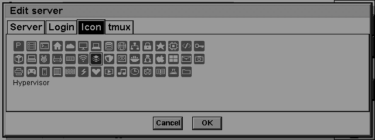</a></td>
</tr>
<tr><td colspan="2"><b>Connections as tabs, tmux windows below</b></td></tr>
<tr>
<td><a href="docs/screenshots/netbook-05-tabs.png"></a></td>
<td><a href="docs/screenshots/5mx-05-tabs.png">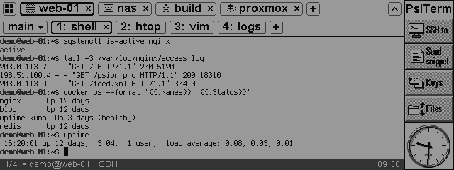</a></td>
</tr>
<tr><td colspan="2"><b>Switch tmux sessions from the drop-down</b></td></tr>
<tr>
<td><a href="docs/screenshots/netbook-06-sessions.png">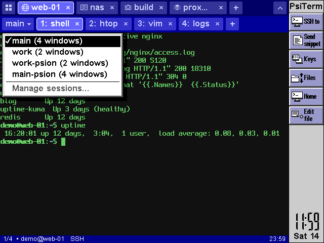</a></td>
<td><a href="docs/screenshots/5mx-06-sessions.png">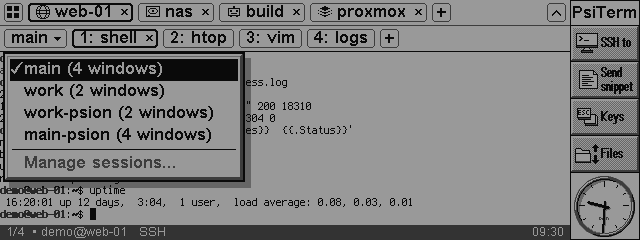</a></td>
</tr>
<tr><td colspan="2"><b>A menu on each server</b></td></tr>
<tr>
<td><a href="docs/screenshots/netbook-07-row-menu.png">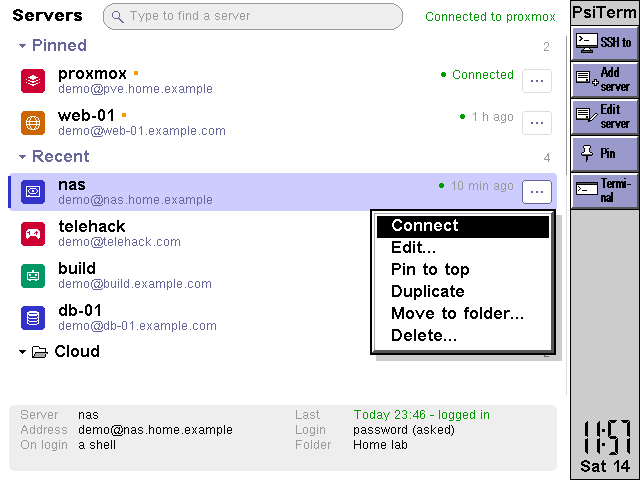</a></td>
<td><a href="docs/screenshots/5mx-07-row-menu.png">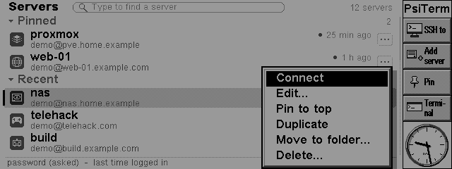</a></td>
</tr>
<tr><td colspan="2"><b>More folders, each server with its own icon</b></td></tr>
<tr>
<td><a href="docs/screenshots/netbook-08-more-folders.png">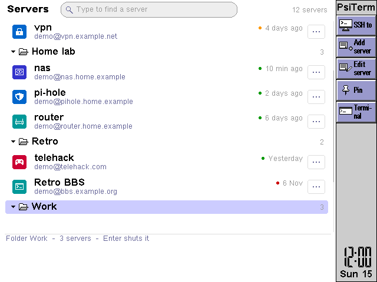</a></td>
<td><a href="docs/screenshots/5mx-08-more-folders.png">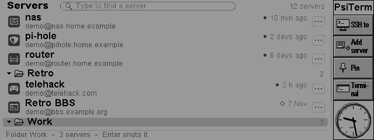</a></td>
</tr>
<tr><td colspan="2"><b>Connection settings, named as in PsiMail and PsiWeb (1.14)</b></td></tr>
<tr>
<td><a href="docs/screenshots/netbook-09-connection-link.png">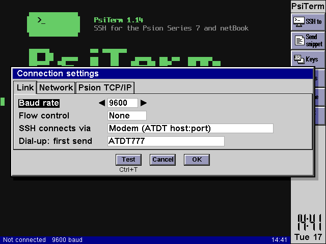</a></td>
<td><a href="docs/screenshots/5mx-09-connection-link.png">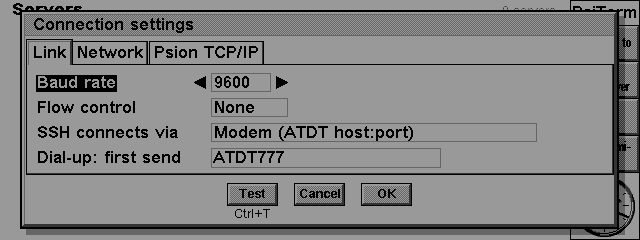</a></td>
</tr>
<tr>
<td></td>
<td><a href="docs/screenshots/5mx-10-connection-network.png">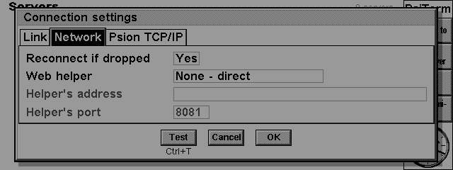</a></td>
</tr>
</table>

## What's new

**PsiTerm 1.11** (since 1.05, the last signed release; not released yet)

New:
- Runs on the netBook and Series 7 as well as the 5mx: in colour, on the whole 640x480 screen, with colour schemes for the terminal and taller tab rows for a finger. The same PsiTerm.sis installs on all three.
- Servers can go in folders, each with one of 43 icons. Pinned and Recent come first on the Start view.
- Type on the Start view to find a server by name, address, user or folder. Esc clears it.
- One dialog to add or edit a server, with Server, Login, Icon and tmux pages.
- Each server has a menu (its ... button, or Tab): Connect, Edit, Pin to top, Duplicate, Move to folder, Delete.
- File > Import servers... reads another PsiTerm's Hosts.dat or an OpenSSH config file.
- Open connections show as tabs, with tmux's windows as a second row. x closes one, + opens another.
- View > Show tabs (Shift+Ctrl+W), or the ^ by the tabs, hides both rows.
- tmux sessions are in a drop-down list (Shift+Ctrl+G).
- The program icon is in colour on a colour screen.

Changed:
- Shift+Ctrl+W and Shift+Ctrl+G are taken by the above. A snippet that used either loses it.

Fixed:
- A Hosts.dat copied over while PsiTerm was open got overwritten.
- A tmux session you had just made dropped out of the list once there were more than six.

The notes for each test build follow.

**PsiTerm 1.15** (not yet released)
- **PsiWeb's full browser.** PsiWeb 0.88's File > Open in full browser
  starts PsiTerm (or hands it the request, if it runs already) with one of
  your saved servers, by its name, and a browser to run there with the page:
  Carbonyl (Chrome drawn in the terminal) or w3m. The saved server's own
  login is used; only its command on login is replaced, for that
  connection. A request names a server already saved: nothing new is
  trusted. ("ssh:" followed by the server's name, a tab and the command, on
  PsiTerm's command line or as a message to it.)

**PsiTerm 1.14** (not yet released)
- **The connection is called the same in every program.** Connection
  settings > Link > SSH connects via now offers *Network card or dial-up
  (Psion TCP/IP)* where it said *Psion Internet (PPP)*: the same setting,
  named so that a netBook with a network card finds it. The page that holds
  *After use* is called Psion TCP/IP. The optional proxy is now the **Web
  helper** (*None - direct*, or the Atom modem helper or PsiProxy on a
  computer), as in PsiMail and PsiWeb. Only the words changed: PsiLink.ini
  and every setting are as they were.

**PsiTerm 1.09** (not yet released)
- **A new tmux session stays in the session list.** With more than six
  sessions the drop-down showed tmux's first six by name, so a session just
  made dropped out of it as soon as another was in use. It now shows the
  seven used last, newest first (the rest are under Manage sessions..., which
  lists up to 24). PsiTerm also asks tmux again whenever the list opens or
  the tabs are tapped.

**PsiTerm 1.08** (not yet released)
- **One place to add and edit a server.** Add server... (Ctrl+N) and Edit
  server... (Ctrl+I) open one dialog with four pages: Server (name, address,
  user, folder, Pin to top), Login (key or password, command on login), Icon
  and tmux (the server's own tmux settings). Folder & icon... and the tmux...
  button have gone into it.
- **43 icons** (27 more: Raspberry Pi, router, switch, Wi-Fi, hypervisor,
  shield, disk, container, Linux, Apple, Windows, mail, camera, printer,
  game, phone, rack, firewall and others), chosen from a grid.
- **A menu on each server**: the ... button at the end of its row, or Tab.
  Connect, Edit..., Pin to top, Duplicate, Move to folder..., Delete....
- **Find a server.** Type on the Start view and only the servers with that
  text in their name, address, user or folder stay (Esc clears it). This
  replaces "type a letter to go to a server".
- **The Start view's sections** are always Pinned, Recent (the three or four
  used last, whichever folder they are in), each folder, then the rest, with
  an Add server row at the end and a friendlier page when nothing is saved.
- **File > Import servers...** adds the servers in a file that are not here
  already (the same address, port and user): a PsiTerm Hosts.dat, or an
  OpenSSH config file (Host, HostName, User, Port). Folders, icons and pins
  come across. A saved password comes across only between files of the same
  Psion (it is scrambled with the Psion's own number): otherwise the server
  asks for it.
- **A Hosts.dat copied onto the Psion while PsiTerm is open is no longer
  lost.** PsiTerm notices the file has changed, takes its servers in, and
  only then saves.
- Hosts.dat's layout is as in 1.06.

**PsiTerm 1.07** (not yet released)
- **The tabs as Muxedo's.** Both rows are now rounded tabs, the one in use
  outlined, and tmux's windows read "1: name". Each connection's tab has an
  x that ends it, and each window's an x that closes it (both ask first; on
  the 5mx only the window in use has one, to keep the tabs readable). A +
  after the connections is the Start view, for another one; a + after the
  windows is a new tmux window.
- **View > Show tabs** (Shift+Ctrl+W), and ^ at the right of the tabs,
  hides both rows and gives the terminal the room; tmux's own status line
  shows meanwhile. PsiTerm remembers it. On the netBook the rows are taller,
  for a finger.
- View > Bold text is now View > Font > Bold text. Shift+Ctrl+W is Show
  tabs: a snippet that had that key loses it.
- No response time on the tabs yet: PsiTerm does not measure one.

**PsiTerm 1.06** (not yet released)
- **Folders on the Start view.** Edit > Folder & icon... (Ctrl+F) puts a
  server in a folder: None, one you have, or a new one. Each folder is a
  heading with its servers under it; Enter or a tap on the heading shuts or
  opens it (Left and Right too), and PsiTerm remembers which are shut.
  Pinned servers stay at the top. Edit > Rename folder... renames one.
- **An icon for each server**, chosen from sixteen in the same dialog
  (server, terminal, home, cloud, desktop, laptop, database, globe, network,
  lock, star, chip, code, key, box, Psion), in place of its initial.
- **Connections as tabs.** With two or more connections open, a row of tabs
  above the terminal shows each with its icon and name: tap one to bring it
  in front. The button at its left is the Start view. On the netBook's
  taller screen the row is there with one connection too.
- **tmux's sessions as a drop-down list.** The session's name sits at the
  left of the window tabs: tap it, or press Shift+Ctrl+G, for the list of
  sessions, and choose one to switch to it. tmux > Sessions is the same
  list; Manage sessions... there is the old dialog (new, rename, close).
- Shift+Ctrl+G is now that list: a snippet that had that key loses it.
- Saved servers are kept as before. Hosts.dat gains a part at its end for
  the folders and icons, which PsiTerm 1.05 and earlier do not read.

**PsiTerm 1.05**
- **tmux > Sessions... works again.** With two or more tmux sessions it
  closed PsiTerm (USER 19 or 23); the editor's File > Recent had the same fault
  with two or more recent files.
- **A colour screen starts in the Clean theme** (Dark before). A Psion still on
  the old default moves to Clean once; a theme you chose is kept.
- **On the netBook's taller screen** the toolbar has Home (the Start view, with
  every connection still up) and Edit file, and the Start view's has Edit
  server. A Series 5mx has room for neither and is unchanged.
- **Dial-up errors in words.** "No Internet connection is chosen as the
  default - set one in Control panel > Internet" rather than "error -3006",
  and the same for the login refusals.

**PsiTerm 1.04**
- **Several connections at once.** Over Psion Internet PsiTerm keeps up to
  four SSH connections open. Connect to another server from the Start view
  while one is up and it opens beside it; the others run on behind. File >
  Connections lists them and Shift+Ctrl+Space goes to the next; the status line
  says which one is in front (2/3), and the Start view marks the servers
  connected now (Enter on one goes to it). End SSH brings the next one in
  front. The modem route is one raw pipe, so it carries one connection.

**PsiTerm 1.03**
- **A modern Start view.** A light page with a large title: your servers in
  two-line rows (the name, then user@address) with a badge of each one's
  initial, grouped under Pinned and Recent, when you last used each ("2 h
  ago") and how it went (a dot). A soft rounded highlight; on the Series 7,
  each server's badge its own colour, and a card of details below.
- **Markdown, formatted.** A .md file opens formatted in the editor:
  headings, bold, italic, `code`, code blocks, lists with bullets, numbered
  lists, task boxes, quotes, rules and links. View > Formatted (Ctrl+P)
  switches to the text to edit it (or just start typing: the text opens at
  that line), and back.
- The editor's text lines sit closer, one line a row.

**PsiTerm 1.02**
- **The Start view.** PsiTerm opens on your saved servers (as Muxedo's
  landing page): pinned ones first, then the rest by when you last used
  them, with how the last connection went (on the Series 7, a coloured mark
  and a panel of details). Enter connects; type a letter to go to a server;
  Ctrl+N, Ctrl+I and Ctrl+D create, change and delete; Ctrl+P pins.
  File > SSH to address... (Ctrl+G) connects to `user@host:port` without
  saving it first. Shift+Ctrl+S brings the Start view back over the
  terminal; Ctrl+Q goes back to the terminal.
- **Edit files on the server.** File > Files > Edit file on server...
  (Shift+Ctrl+O) opens a text file (up to 64 KB) in an editor of its own,
  over SFTP: Save (Ctrl+S), Find (Ctrl+F), Replace (Ctrl+R), Go to line
  (Ctrl+L), Undo, word wrap, zoom, LF or CR LF lines, and the last files
  you edited on that server under File > Recent. Saving checks the file has
  not changed on the server since you opened it (and asks if it has), and
  writes it beside the old one first, then renames it over, so a dropped
  link never leaves half a file. A file with characters the Psion can't
  show opens read only.
- **Recent commands.** Snippets > Recent commands... (Shift+Ctrl+R) lists
  the commands you typed on this server (not in full-screen programs or at
  password prompts): send one again, or save it as a snippet.
- **Snippets on the menu.** Each snippet says whether it is on the Snippets
  menu (Edit > Menu page), wherever its folder; Manage snippets has Copy.
- Shift+Ctrl+O and Shift+Ctrl+R are now Edit file on server and Recent
  commands: a snippet that had one of those keys loses it.

**PsiTerm 1.01**
- **tmux as Muxedo has it.** tmux > tmux settings... sets the defaults:
  start in tmux on logging in, the session's name, a session of the Psion's
  own (grouped with the main one: the same windows, but its own size and
  current window), tmux options set on attach (standard: `window-size latest`
  and `aggressive-resize on`, so a bigger screen on the same session is not
  squeezed), the prefix key, and a note when the server has no tmux. Each
  saved server can override any of them (SSH to > Edit > tmux...; since 1.08
  the tmux page of Edit server...); a
  server's Command on login still overrides everything.
- **tmux > Sessions...** lists tmux's sessions: switch to one, or make,
  rename or close one.
- **More window and pane commands:** Close window, Even layout, Pane to
  window, Close pane. Window and pane commands now go to tmux on a channel
  of their own, so they work whatever has the keyboard (vim's insert mode,
  a prompt). Rename window asks for the name in a dialog.
- **tmux history.** View > Scroll > tmux history brings the pane's own
  history into PsiTerm's scrollback.
- **tmux tabs fixed on more servers.** Where a server runs commands without
  a UTF-8 locale, tmux sent its window list in a form PsiTerm could not
  read, so the tabs fell back to reading the status line; and after the
  Psion's tick count passed 2^31 PsiTerm stopped asking tmux at all.
- **Snippets in a new tmux window.** A snippet can run in a new window of
  its own (Manage snippets > Edit > Run in).

**PsiTerm 1.00**
- **More colour themes on the Series 7 and netBook.** Besides Dark, Light,
  High contrast and Soft: Slate, Clean, Dracula, Nord, Solarized Dark, One
  Dark, Gruvbox Dark, Monokai, Tokyo Night, Homebrew and Matrix (Tools >
  Preferences > Theme). Each has its own 16 standard colours.
- **tmux tabs in colour.** On a colour screen the tab strip is navy, like the
  status line, and the current window's tab takes the theme's colours. The
  5mx's tabs are unchanged.

**PsiTerm 0.99**
- **Colour on the Series 7 and netBook.** PsiTerm shows the server's colours
  (all 256; full 24-bit colour comes out as the nearest of them) on the
  640x480 colour screen, and uses the whole of it. Themes there: Dark (the
  standard), Light, High contrast and Soft. Coloured text that would be hard
  to read on the paper (yellow on white, dark blue on black) is made lighter
  or darker, keeping its colour. The status line is the Series 7's navy.
  Reading mode and Screen greys belong to the 5mx's grey screen, so a colour
  screen does not show them. The 5mx draws exactly as before.
- **New typefaces.** Besides Terminus (now also at 24 pixels) PsiTerm has
  Spleen (12, 16 and 24), Gohufont (11 and 14) and Cozette (13). Pick one in
  View > Font > Other font...: the Font menu and the zoom keys then go round
  its sizes. A new Series 7 install starts in Spleen 16 (71x29).
- **Echo time.** With Tools > Debug > Keep a log on, the status line shows
  how long a key takes to come back from the server, to help find slowness.

**PsiTerm 0.98**
- **Runs on the netBook.** SSH no longer stops with KERN-EXEC 3 while
  setting up encryption on a Psion netBook (or Series 7). The compiler's
  helper routines ended with an instruction the netBook's StrongARM does
  not have; they are now linked without it. The Series 5mx is unaffected.
- **Send log to server through the Atom modem.** With the shared proxy set
  to the Atom's own (`psiproxy`), Send log goes through the modem to
  PsiProxy when the modem knows where it is (firmware 2.7, `AT$PU`), and
  otherwise says "Needs PsiProxy on a computer".

**PsiTerm 0.97**
- **No log unless you ask for one.** Tools > Debug > **Keep a log** is off
  as standard, also for anyone updating: PsiTerm then writes no log file
  at all. Tick it to keep PsiTerm.log again; *Send log to server* is dimmed
  until it is ticked.

**PsiTerm 0.95**
- **One shared proxy**, set once in Connection settings > Network > Use
  proxy, for the suite's web traffic and Send log. It is optional and off as
  standard, with no address built in.
  [PsiProxy](https://github.com/danieledge/psiproxy) is the proxy made for
  these apps. [Choosing your setup](https://github.com/danieledge/psion-core/blob/main/docs/SETUP.md) compares the set-ups.
- **Send log to server** (Tools > Debug) sends PsiTerm's log to your
  PsiProxy when something goes wrong. (Since 0.97 the log is kept only
  with Tools > Debug > Keep a log ticked.)
- **Psion Internet can stay connected** after use, until you disconnect
  (Connection settings > Network > After use, Psion Internet). It is the
  standard on a new Psion; anyone updating keeps the old idle hang-up until
  they change it.
- Steadier dial-up: a connection the Psion only thinks is up is noticed and
  dialled again, and a second app shares the link instead of re-dialling.
- Get file and Send file browse in a file view of their own.

**PsiTerm 0.86**
- **Snippets now have folders.** Each folder is a menu cascade, and a
  ready-made **Claude Code** folder holds that program's keys (Interrupt,
  Rewind, Switch mode) and its /clear, /compact, /resume, /help commands,
  all ordinary, editable snippets. The old fixed Keys > Claude Code menu is
  gone.
- The **"SSH to" dialog** keeps its buttons on one bottom row, so it no longer
  leaves a tall empty gap.
- Screen greys are tuned from Preferences across all the programs, and every
  settings dialog fits the 640x240 screen.

**Earlier**
- 0.73: a **Files** button on the toolbar pops up Send file, Get file and Log
  to file; **tmux windows as tabs**, drawn as EIKON's own dialog page tabs in
  place of tmux's status line (tap one to switch, Ctrl+Tab for the next).
- 0.72: file transfer over SFTP and a session log.
- A **Test** button in Connection settings, and the
  [PsiConnect modem firmware](https://github.com/danieledge/psiconnect).

## What it does

A native EPOC terminal (libvterm-based, xterm-256color) wrapping a port of the
**Dropbear SSH** client. It connects through anything that behaves like a
Hayes modem on the serial port - for example a Wi-Fi RS-232 modem - by
dialling `ATDT host:port`, or over the Psion's own dial-up (PPP) TCP/IP stack.

Modern servers work: curve25519 key exchange, Ed25519/RSA host keys,
chacha20-poly1305, zlib compression. It is fast enough to run tmux, vim, htop -
and Claude Code - on a 1999 palmtop.

- SSH with saved servers and (optionally) saved passwords; a block-drawn
  start screen
- SSH keys (Tools > SSH keys): make Ed25519 keys on the Psion or import
  your own (OpenSSH or Dropbear, Ed25519 or RSA), each named, with its
  fingerprint; show, rename, regenerate or delete them. File > Install
  login key on server adds one to a server, and each saved server chooses its
  key, a saved password, or to ask
- File transfer over the logged-in connection (SFTP, no second login):
  File > Send file picks a Psion file with the standard Open file dialog,
  then a folder on the server; File > Get file browses the server's
  folders (names and sizes) and saves with the standard Save as dialog.
  The folders are a file view of PsiTerm's own (0.91), with its own menus and
  toolbar (Up, Favourite, Get or Send here, Close): it opens folders in place,
  and keeps favourite folders per server at the top of its Location pane.
  Progress with Stop; works over a 57600 baud modem; a stopped or failed
  download leaves no half file. Servers without SFTP are told apart
- Up to four SSH connections at once over Psion Internet (File >
  Connections, Shift+Ctrl+Space)
- Session log (File > Log to file): everything received, as plain text
  (escape sequences taken out) or raw, to a file you choose; "Log" on the
  status line while it runs
- Snippets: your own commands and prompts on a menu and on Shift+Ctrl
  hotkeys, grouped in folders (each a menu cascade), with escapes for any key
  sequence (`\n`, `^C`, `\e`). A ready-made Claude Code folder has that
  program's keys (interrupt, rewind, switch mode, /clear, /compact...)
- tmux windows shown as tabs, drawn as EIKON's dialog page tabs at the top of
  the screen in place of tmux's status line: tap one to switch, Ctrl+Tab /
  Shift+Ctrl+Tab for the next / previous, arrows at the ends when there are
  many. PsiTerm asks tmux for the window list on a channel of its own, and
  falls back to reading tmux's status line
- A tmux menu (windows, splits, panes, zoom, scroll mode, detach)
- Themes (classic, inverted, high contrast, soft), cursor styles, and a status
  line with the connection state and clock
- Auto-reconnect when a session drops (Psion switched off, Wi-Fi gone), with an
  optional per-server command on login such as `tmux new -A -s psion` to land
  back where you were
- Four typefaces: Terminus (12 to 24), Spleen, Gohufont and Cozette, plus
  Courier; optional bold; 16 greys on the 5mx, 256 colours on the Series 7
  and netBook. View > Font > Other font... picks any font the Psion has (the
  ROM's, and any `.gdr` in `\System\Fonts\` on any disk) at any of its sizes;
  a proportional font is spaced out to keep the columns
- The standard EIKON toolbar: SSH to (End SSH while connected), then the Send
  snippet, Keys and Files pop-ups (Files: Send file, Get file, Log to file),
  and the clock. The sidebar's zoom icons zoom the terminal (as View > Zoom
  in / Zoom out). View > Show toolbar (Shift+Ctrl+B)
  hides it and the terminal takes the full width - 106 columns instead of 95
  in Terminus 12, 80 instead of 71 in Terminus 14/16, 64 instead of 57 in
  Terminus 18 - with the server told to reflow, even mid-session; remembered
- Stylus as a mouse when a program asks for one (tmux with mouse on, vim,
  htop): tap to click - panes, tmux windows, buttons - and drag up or down to
  scroll. Shift+stylus still selects text
- Scrollback, pen selection, copy/paste with the system clipboard
- Box drawing, block and Braille graphics drawn natively
- Tools > Help on PsiTerm (Shift+Ctrl+H)
- Signed over-the-air updates straight from GitHub (TLS 1.3 on a 36 MHz ARM)
- An on-device crypto speed test (Tools > Debug)

## Installing

1. **Download**
   [PsiTerm.sis](https://github.com/danieledge/psiterm/raw/main/dist/PsiTerm.sis)
   from `dist/` (always the latest version: see `dist/version.txt`). The
   same folder carries
   [PsiMail.sis](https://github.com/danieledge/psiterm/raw/main/dist/PsiMail.sis)
   and
   [PsiWeb.sis](https://github.com/danieledge/psiterm/raw/main/dist/PsiWeb.sis),
   because installed copies of those apps fetch their updates from here (see
   [Updates](#updates)); their source is in their own repositories.
2. **Copy** them to the Psion: the easiest way is a **CF card** in a PC card
   reader (for example into `D:\Install\`), or PsiWin.
3. **Open** each .sis on the Psion and install to **D:** (the CF card) if you
   have one. The apps appear on the Extras bar.

Each installer also offers the EPOC "Standard C Library" (ESTLIB.DLL), which
the apps need and the 5mx ROM lacks - say OK if asked. Installing a newer
version replaces the old one.

After that the apps **update themselves over the air**: Tools > Update
PsiTerm fetches the newest signed release from GitHub - see
[Updates](#updates).

Then: Tools > Connection settings (see below), and SSH to (Shift+Ctrl+S) >
New for your first server. `docs/FIRSTRUN.TXT` is a step-by-step first run
with a WiRSa modem, written for PsiTerm 0.35 (some menu names have changed
since).

## Connecting

All the apps share one set of connection settings (Tools > Connection
settings in any of them, kept in `C:\System\Data\PsiLink.ini`). The serial
port can be used by one program at a time, so the Psion's **Remote link must
be off** (Ctrl+L on the System screen), and only one app uses the modem at
once - File > Disconnect or Hang up frees it.

**Test** (Ctrl+T) in Connection settings tries the settings shown, before OK:
for a modem, whether it answers and at what baud rate, CTS and DCD, the
modem's name, and whether RTS/CTS will work; for Psion TCP/IP, whether the
connection is up and names can be looked up (it asks before dialling).

- **Network card or dial-up (Psion TCP/IP)**: the Psion's own TCP/IP, set up
  in the Control panel's Internet and Modems settings: a netBook's PC Card
  network card, or a dial-up (PPP) connection through a phone or a PPP
  server. The apps start it when they need it and the Psion's connection
  dialogs appear. (Until 1.13 this was called "Psion Internet (PPP)"; the
  setting itself did not change.)
- **A Wi-Fi serial modem** such as a WiRSa or a WiFi232: the apps dial
  `ATDT host:port` and talk through the connection the modem makes. Set the
  baud rate to the modem's; 115200 with RTS/CTS flow control is fastest if
  the cable carries those lines, otherwise choose None.
- **The Atom modem**: [PsiConnect](https://github.com/danieledge/psiconnect)
  turns an M5Stack Atom on an Atomic RS232 Base into a Hayes-style Wi-Fi
  modem that works exactly like a WiRSa, plus **output pacing** so the Psion
  is never overrun even on a three-wire cable without RTS/CTS. Its README has
  the wiring, flashing, Wi-Fi set-up and the settings to use. It has a web
  helper of its own for PsiWeb and PsiMail, the **Atom modem helper**; it is
  not PsiProxy, so *Send log to server* still needs a PsiProxy on a
  computer: set it in the modem's own settings (AT$PU) and the log goes
  through the Atom.
- **After use, Psion TCP/IP** (Connection settings > Psion TCP/IP): *Stays
  connected* (the standard on a new Psion) keeps the connection up after
  use, for all the apps, until you disconnect; *Disconnects when idle*
  leaves it to the Psion's own idle time, as before. Anyone updating from an
  older version keeps *Disconnects when idle* until they change it. The
  modem route always hangs up after use.

### The web helper (optional)

**You do not need one.** Connection settings > Network > **Web helper** is
*None - direct* as standard, and no address is built in. PsiTerm never sends
its connections through a helper: SSH, SFTP, tmux and updates all go direct.
There are two kinds, named the same way in every program of the suite: the
**Atom modem helper** (address `psiproxy`, port 8080) and **PsiProxy on a
computer** (its address, port 8081;
[github.com/danieledge/psiproxy](https://github.com/danieledge/psiproxy)).
The only thing a helper adds to PsiTerm is *Send log to server* (Tools >
Debug), which sends PsiTerm's log to your own PsiProxy to help find a fault.
PsiTerm keeps that log only while Tools > Debug > *Keep a log* is ticked (it
is off as standard). For what the helper does for PsiMail and PsiWeb, see
their READMEs. Logs go as plain HTTP and can hold host and account names, so
send them only to your own PsiProxy.

## Updates

Tools > Update PsiTerm asks where to look (GitHub, its test builds, or a
local server), downloads the newest release over the same modem or dial-up
link, checks it and offers to install it. From GitHub, it reads
`dist/version.txt` on `main` (or `dev` for test builds), then fetches the
release itself from that version's tag (`v0.95/dist/`), which never changes.
PsiMail and PsiWeb read `dist/PsiMail-version.txt` and
`dist/PsiWeb-version.txt` in this repository the same way, which is why their
releases are published here.

The Psion speaks a minimal TLS 1.3 client (`core/ssh/tls13.c`: X25519,
ChaCha20-Poly1305). Every release is signed with Ed25519, and each app checks
the signature against the release key built into it before installing
anything - so updates are trustworthy from GitHub or anywhere else. How
releases are made and signed is in psion-core's
[BUILDING.md](https://github.com/danieledge/psion-core/blob/main/docs/BUILDING.md#updates-and-signing).

## Building from source

The shared layer (the connection code, TLS, zlib, the tools and the build
container) is the [psion-core](https://github.com/danieledge/psion-core)
submodule at `core/`, so clone with it:

```sh
git clone --recurse-submodules https://github.com/danieledge/psiterm.git
cd psiterm
core/tools/docker/psibuild setup        # once: the build image and the SDK, beside the checkout
core/tools/docker/psibuild "bash build.sh"   # dist/PsiTerm.sis
```

Without Docker you need Linux, wine, and the EPOC R5 C++ SDK with the gcc
3.0 Psion toolchain
([psion_cpp_sdk_linux](https://github.com/static-void/psion_cpp_sdk_linux)):
`PSION_SDK=/path/to/psion_cpp_sdk_linux ./build.sh`. This builds libvterm
(`build_vterm.sh`), `psissh.exe` (`ssh/Makefile`: Dropbear plus `psishim.c`,
`sftp.c` and `tmuxq.c`, with psiglue, TLS and the crypto libraries from
core), the app (`app/`) and its toolbar pictures, and packages
`dist/PsiTerm.sis`.

psion-core's [BUILDING.md](https://github.com/danieledge/psion-core/blob/main/docs/BUILDING.md)
has the layout, the stale-object warning and the release steps, and its
[TESTING.md](https://github.com/danieledge/psion-core/blob/main/docs/TESTING.md)
describes how the apps are tested. PsiTerm's own host tests are in
`ssh/test/` (`Makefile.host` builds `psissh-host`, the real Dropbear client on
a PC, for `e2e.py`, `sftp_test.py` and `update.py` against a throwaway sshd),
and the emulator tools in `core/tools/emu/` run the real package on the real
ROM (`node --experimental-strip-types core/tools/emu/mkcard.ts psiterm`, then
`core/tools/emu/run.sh start`).

## The suite

| Repository | What it is |
|---|---|
| [psiterm](https://github.com/danieledge/psiterm) | PsiTerm, this one: SSH, SFTP, tmux tabs |
| [psimail](https://github.com/danieledge/psimail) | PsiMail: IMAP/SMTP email with TLS, a calendar synced with the Agenda, contacts |
| [psiweb](https://github.com/danieledge/psiweb) | PsiWeb: a web browser (Links 2) |
| [psicast](https://github.com/danieledge/psicast) | PsiCast: the Psion's screen in a phone's browser, through the Atom |
| [psilinux](https://github.com/danieledge/psilinux) | PsiLinux: Linux and Alpine Linux on the 5mx |
| [psiconnect](https://github.com/danieledge/psiconnect) | PsiConnect: the Atom modem firmware |
| [psiproxy](https://github.com/danieledge/psiproxy) | PsiProxy: the optional helper on a computer on your network |
| [psion-core](https://github.com/danieledge/psion-core) | The shared code and tools, the `core/` submodule of each program |

The suite's home page is [danieledge.github.io/psion](https://danieledge.github.io/psion/).

## Support

If PsiTerm brings your Psion back to life and you'd like to say thanks,
you can [buy me a coffee](https://buymeacoffee.com/danedge).

## Licence and credits

MIT for the project's own code - see `LICENSE`. Bundled components keep
their own licences - see [`THIRD-PARTY.md`](THIRD-PARTY.md): Dropbear SSH
(with LibTomCrypt, LibTomMath and TweetNaCl), libvterm, zlib and the
Terminus, Spleen, Gohufont and Cozette fonts.

(c) Dan Edge
