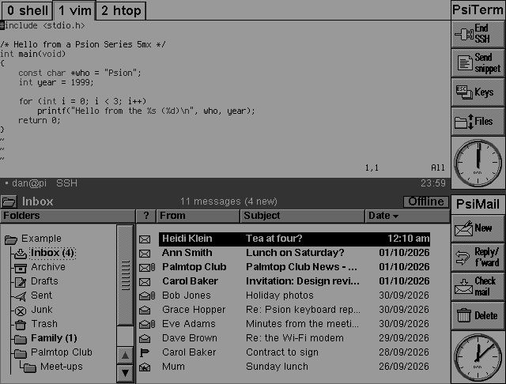
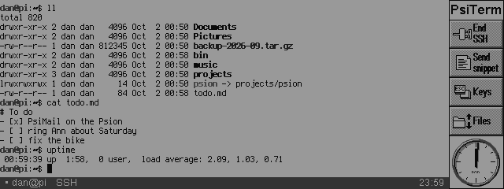
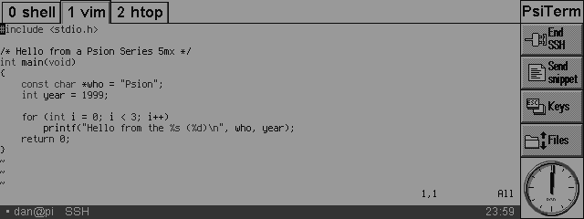
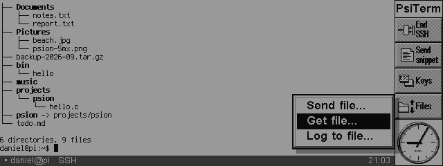
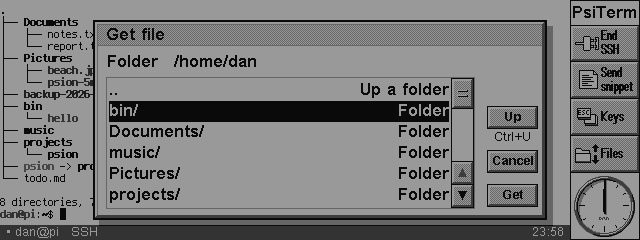
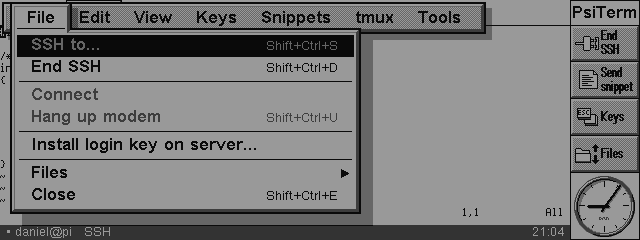
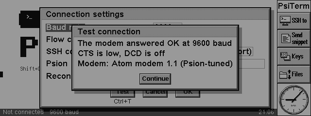

# PsiTerm

**An SSH terminal for the 1999 Psion Series 5mx:** tmux, vim, htop and
Claude Code on a 36 MHz palmtop, as a native EPOC app that looks and behaves
like the Psion's own programs. PsiTerm is part of a suite that brings the
5mx into 2026: see [The suite](#the-suite) for PsiMail (email and calendar),
PsiWeb (a web browser), PsiCast (screen sharing), PsiLinux, the PsiConnect
modem firmware and PsiProxy.

> **Alpha - pre-v1. Expect bugs!** The apps are new and changing fast. They
> work well enough for daily SSH, tmux, Claude Code and email on a real 5mx,
> but things will break. Bug reports (a photo of the screen is perfect) are
> very welcome via [GitHub issues](https://github.com/danieledge/psiterm/issues).

[](https://github.com/danieledge/psiterm/raw/main/dist/PsiTerm.sis)
[](https://github.com/danieledge/psiterm/raw/main/dist/PsiMail.sis)
[](https://github.com/danieledge/psiterm/raw/main/dist/PsiWeb.sis)
[](https://buymeacoffee.com/danedge)

<p align="center"></p>

PsiTerm 0.95. It shares one connection layer with the other apps
([psion-core](https://github.com/danieledge/psion-core)): a Wi-Fi modem on
the serial port (`ATDT host:port`) or the Psion's own dial-up TCP/IP. Modern
servers work: curve25519, Ed25519, ChaCha20-Poly1305 and TLS 1.3, all on the
Psion's ARM710.

## Contents

- [Screenshots](#screenshots)
- [What's new](#whats-new)
- [What it does](#what-it-does)
- [Installing](#installing)
- [Connecting](#connecting)
- [Updates](#updates)
- [Building from source](#building-from-source)
- [The suite](#the-suite)
- [Support](#support) · [Licence and credits](#licence-and-credits)

## Screenshots

Taken in a Series 5mx emulator at the Psion's own 640x240 resolution. Tap or
click one to see it full size.

<table>
<tr>
<td><a href="docs/screenshots/psiterm-ssh.png"></a><br>An SSH session</td>
<td><a href="docs/screenshots/psiterm-tmux-tabs.png"></a><br>tmux windows as tabs</td>
</tr>
<tr>
<td><a href="docs/screenshots/psiterm-files.png"></a><br>The toolbar's Files pop-out</td>
<td><a href="docs/screenshots/psiterm-get-file.png"></a><br>Get file (SFTP)</td>
</tr>
<tr>
<td><a href="docs/screenshots/psiterm-file-menu.png"></a><br>The File menu</td>
<td><a href="docs/screenshots/psiterm-test.png"></a><br>Connection settings > Test</td>
</tr>
</table>

## What's new

**PsiTerm 0.97**
- **No log unless you ask for one.** Tools > Debug > **Keep a log** is off
  as standard, also for anyone updating: PsiTerm then writes no log file
  at all. Tick it to keep PsiTerm.log again; *Send log to server* is dimmed
  until it is ticked.

**PsiTerm 0.95**
- **One shared proxy**, set once in Connection settings > Network > Use
  proxy, for the suite's web traffic and Send log. It is optional and off as
  standard, with no address built in.
  [PsiProxy](https://github.com/danieledge/psiproxy) is the proxy made for
  these apps.
- **Send log to server** (Tools > Debug) sends PsiTerm's log to your
  PsiProxy when something goes wrong. (Since 0.97 the log is kept only
  with Tools > Debug > Keep a log ticked.)
- **Psion Internet can stay connected** after use, until you disconnect
  (Connection settings > Network > After use, Psion Internet). It is the
  standard on a new Psion; anyone updating keeps the old idle hang-up until
  they change it.
- Steadier dial-up: a connection the Psion only thinks is up is noticed and
  dialled again, and a second app shares the link instead of re-dialling.
- Get file and Send file browse in a file view of their own.

**PsiTerm 0.86**
- **Snippets now have folders.** Each folder is a menu cascade, and a
  ready-made **Claude Code** folder holds that program's keys (Interrupt,
  Rewind, Switch mode) and its /clear, /compact, /resume, /help commands,
  all ordinary, editable snippets. The old fixed Keys > Claude Code menu is
  gone.
- The **"SSH to" dialog** keeps its buttons on one bottom row, so it no longer
  leaves a tall empty gap.
- Screen greys are tuned from Preferences across all the programs, and every
  settings dialog fits the 640x240 screen.

**Earlier**
- 0.73: a **Files** button on the toolbar pops up Send file, Get file and Log
  to file; **tmux windows as tabs**, drawn as EIKON's own dialog page tabs in
  place of tmux's status line (tap one to switch, Ctrl+Tab for the next).
- 0.72: file transfer over SFTP and a session log.
- A **Test** button in Connection settings, and the
  [PsiConnect modem firmware](https://github.com/danieledge/psiconnect).

## What it does

A native EPOC terminal (libvterm-based, xterm-256color) wrapping a port of the
**Dropbear SSH** client. It connects through anything that behaves like a
Hayes modem on the serial port - for example a Wi-Fi RS-232 modem - by
dialling `ATDT host:port`, or over the Psion's own dial-up (PPP) TCP/IP stack.

Modern servers work: curve25519 key exchange, Ed25519/RSA host keys,
chacha20-poly1305, zlib compression. It is fast enough to run tmux, vim, htop -
and Claude Code - on a 1999 palmtop.

- SSH with saved servers and (optionally) saved passwords; a block-drawn
  start screen
- SSH keys (Tools > SSH keys): make Ed25519 keys on the Psion or import
  your own (OpenSSH or Dropbear, Ed25519 or RSA), each named, with its
  fingerprint; show, rename, regenerate or delete them. File > Install
  login key on server adds one to a server, and each saved server chooses its
  key, a saved password, or to ask
- File transfer over the logged-in connection (SFTP, no second login):
  File > Send file picks a Psion file with the standard Open file dialog,
  then a folder on the server; File > Get file browses the server's
  folders (names and sizes) and saves with the standard Save as dialog.
  The folders are a file view of PsiTerm's own (0.91), with its own menus and
  toolbar (Up, Favourite, Get or Send here, Close): it opens folders in place,
  and keeps favourite folders per server at the top of its Location pane.
  Progress with Stop; works over a 57600 baud modem; a stopped or failed
  download leaves no half file. Servers without SFTP are told apart
- Session log (File > Log to file): everything received, as plain text
  (escape sequences taken out) or raw, to a file you choose; "Log" on the
  status line while it runs
- Snippets: your own commands and prompts on a menu and on Shift+Ctrl
  hotkeys, grouped in folders (each a menu cascade), with escapes for any key
  sequence (`\n`, `^C`, `\e`). A ready-made Claude Code folder has that
  program's keys (interrupt, rewind, switch mode, /clear, /compact...)
- tmux windows shown as tabs, drawn as EIKON's dialog page tabs at the top of
  the screen in place of tmux's status line: tap one to switch, Ctrl+Tab /
  Shift+Ctrl+Tab for the next / previous, arrows at the ends when there are
  many. PsiTerm asks tmux for the window list on a channel of its own, and
  falls back to reading tmux's status line
- A tmux menu (windows, splits, panes, zoom, scroll mode, detach)
- Themes (classic, inverted, high contrast, soft), cursor styles, and a status
  line with the connection state and clock
- Auto-reconnect when a session drops (Psion switched off, Wi-Fi gone), with an
  optional per-server command on login such as `tmux new -A -s psion` to land
  back where you were
- Terminus font in four sizes (plus Courier), optional bold, 16 greys. View >
  Font > Other font... picks any font the Psion has (the ROM's, and any `.gdr`
  in `\System\Fonts\` on any disk) at any of its sizes; a proportional font
  is spaced out to keep the columns
- The standard EIKON toolbar: SSH to (End SSH while connected), then the Send
  snippet, Keys and Files pop-ups (Files: Send file, Get file, Log to file),
  and the clock. The sidebar's zoom icons zoom the terminal (as View > Zoom
  in / Zoom out). View > Show toolbar (Shift+Ctrl+B)
  hides it and the terminal takes the full width - 106 columns instead of 95
  in Terminus 12, 80 instead of 71 in Terminus 14/16, 64 instead of 57 in
  Terminus 18 - with the server told to reflow, even mid-session; remembered
- Stylus as a mouse when a program asks for one (tmux with mouse on, vim,
  htop): tap to click - panes, tmux windows, buttons - and drag up or down to
  scroll. Shift+stylus still selects text
- Scrollback, pen selection, copy/paste with the system clipboard
- Box drawing, block and Braille graphics drawn natively
- Tools > Help on PsiTerm (Shift+Ctrl+H)
- Signed over-the-air updates straight from GitHub (TLS 1.3 on a 36 MHz ARM)
- An on-device crypto speed test (Tools > Debug)

## Installing

1. **Download**
   [PsiTerm.sis](https://github.com/danieledge/psiterm/raw/main/dist/PsiTerm.sis)
   from `dist/` (always the latest version: see `dist/version.txt`). The
   same folder carries
   [PsiMail.sis](https://github.com/danieledge/psiterm/raw/main/dist/PsiMail.sis)
   and
   [PsiWeb.sis](https://github.com/danieledge/psiterm/raw/main/dist/PsiWeb.sis),
   because installed copies of those apps fetch their updates from here (see
   [Updates](#updates)); their source is in their own repositories.
2. **Copy** them to the Psion: the easiest way is a **CF card** in a PC card
   reader (for example into `D:\Install\`), or PsiWin.
3. **Open** each .sis on the Psion and install to **D:** (the CF card) if you
   have one. The apps appear on the Extras bar.

Each installer also offers the EPOC "Standard C Library" (ESTLIB.DLL), which
the apps need and the 5mx ROM lacks - say OK if asked. Installing a newer
version replaces the old one.

After that the apps **update themselves over the air**: Tools > Update
PsiTerm fetches the newest signed release from GitHub - see
[Updates](#updates).

Then: Tools > Connection settings (see below), and SSH to (Shift+Ctrl+S) >
New for your first server. `docs/FIRSTRUN.TXT` is a step-by-step first run
with a WiRSa modem, written for PsiTerm 0.35 (some menu names have changed
since).

## Connecting

All the apps share one set of connection settings (Tools > Connection
settings in any of them, kept in `C:\System\Data\PsiLink.ini`). The serial
port can be used by one program at a time, so the Psion's **Remote link must
be off** (Ctrl+L on the System screen), and only one app uses the modem at
once - File > Disconnect or Hang up frees it.

**Test** (Ctrl+T) in Connection settings tries the settings shown, before OK:
for a modem, whether it answers and at what baud rate, CTS and DCD, the
modem's name, and whether RTS/CTS will work; for Psion Internet, whether the
connection is up and names can be looked up (it asks before dialling).

- **Psion Internet (PPP)**: the Psion's own dial-up TCP/IP, set up in the
  Control panel's Internet and Modems settings - a phone or a PPP server. The
  apps start it when they need it and the Psion's connection dialogs appear.
- **A Wi-Fi serial modem** such as a WiRSa or a WiFi232: the apps dial
  `ATDT host:port` and talk through the connection the modem makes. Set the
  baud rate to the modem's; 115200 with RTS/CTS flow control is fastest if
  the cable carries those lines, otherwise choose None.
- **The Atom modem**: [PsiConnect](https://github.com/danieledge/psiconnect)
  turns an M5Stack Atom on an Atomic RS232 Base into a Hayes-style Wi-Fi
  modem that works exactly like a WiRSa, plus **output pacing** so the Psion
  is never overrun even on a three-wire cable without RTS/CTS. Its README has
  the wiring, flashing, Wi-Fi set-up and the settings to use. It has a
  small web proxy of its own for PsiWeb and PsiMail; it is not PsiProxy, so
  *Send log to server* still needs a PsiProxy on a computer: set it in the
  modem's Web proxy settings (AT$PU) and the log goes through the Atom.
- **After use, Psion Internet** (Connection settings > Network): *Stays
  connected* (the standard on a new Psion) keeps the dial-up connection up
  after use, for all the apps, until you disconnect; *Disconnects when
  idle* leaves it to the Psion's own idle time, as before. Anyone updating
  from an older version keeps *Disconnects when idle* until they change it.
  The modem route always hangs up after use.

### The proxy (optional)

**You do not need a proxy.** Connection settings > Network > **Use proxy** is
off as standard, and no address is built in. PsiTerm never sends its
connections through a proxy: SSH, SFTP, tmux and updates all go direct. The
only thing the proxy adds to PsiTerm is *Send log to server* (Tools > Debug),
which sends PsiTerm's log to your own [PsiProxy](https://github.com/danieledge/psiproxy)
to help find a fault. PsiTerm keeps that log only while Tools > Debug >
*Keep a log* is ticked (it is off as standard). For what the proxy does for PsiMail and PsiWeb, see
their READMEs. Logs go as plain HTTP and can hold host and account names, so
send them only to your own PsiProxy.

## Updates

Tools > Update PsiTerm asks where to look (GitHub, its test builds, or a
local server), downloads the newest release over the same modem or dial-up
link, checks it and offers to install it. From GitHub, it reads
`dist/version.txt` on `main` (or `dev` for test builds), then fetches the
release itself from that version's tag (`v0.95/dist/`), which never changes.
PsiMail and PsiWeb read `dist/PsiMail-version.txt` and
`dist/PsiWeb-version.txt` in this repository the same way, which is why their
releases are published here.

The Psion speaks a minimal TLS 1.3 client (`core/ssh/tls13.c`: X25519,
ChaCha20-Poly1305). Every release is signed with Ed25519, and each app checks
the signature against the release key built into it before installing
anything - so updates are trustworthy from GitHub or anywhere else. How
releases are made and signed is in psion-core's
[BUILDING.md](https://github.com/danieledge/psion-core/blob/main/docs/BUILDING.md#updates-and-signing).

## Building from source

The shared layer (the connection code, TLS, zlib, the tools and the build
container) is the [psion-core](https://github.com/danieledge/psion-core)
submodule at `core/`, so clone with it:

```sh
git clone --recurse-submodules https://github.com/danieledge/psiterm.git
cd psiterm
core/tools/docker/psibuild setup        # once: the build image and the SDK, beside the checkout
core/tools/docker/psibuild "bash build.sh"   # dist/PsiTerm.sis
```

Without Docker you need Linux, wine, and the EPOC R5 C++ SDK with the gcc
3.0 Psion toolchain
([psion_cpp_sdk_linux](https://github.com/static-void/psion_cpp_sdk_linux)):
`PSION_SDK=/path/to/psion_cpp_sdk_linux ./build.sh`. This builds libvterm
(`build_vterm.sh`), `psissh.exe` (`ssh/Makefile`: Dropbear plus `psishim.c`,
`sftp.c` and `tmuxq.c`, with psiglue, TLS and the crypto libraries from
core), the app (`app/`) and its toolbar pictures, and packages
`dist/PsiTerm.sis`.

psion-core's [BUILDING.md](https://github.com/danieledge/psion-core/blob/main/docs/BUILDING.md)
has the layout, the stale-object warning and the release steps, and its
[TESTING.md](https://github.com/danieledge/psion-core/blob/main/docs/TESTING.md)
describes how the apps are tested. PsiTerm's own host tests are in
`ssh/test/` (`Makefile.host` builds `psissh-host`, the real Dropbear client on
a PC, for `e2e.py`, `sftp_test.py` and `update.py` against a throwaway sshd),
and the emulator tools in `core/tools/emu/` run the real package on the real
ROM (`node --experimental-strip-types core/tools/emu/mkcard.ts psiterm`, then
`core/tools/emu/run.sh start`).

## The suite

| Repository | What it is |
|---|---|
| [psiterm](https://github.com/danieledge/psiterm) | PsiTerm, this one: SSH, SFTP, tmux tabs |
| [psimail](https://github.com/danieledge/psimail) | PsiMail: IMAP/SMTP email with TLS, a calendar synced with the Agenda, contacts |
| [psiweb](https://github.com/danieledge/psiweb) | PsiWeb: a web browser (Links 2) |
| [psicast](https://github.com/danieledge/psicast) | PsiCast: the Psion's screen in a phone's browser, through the Atom |
| [psilinux](https://github.com/danieledge/psilinux) | PsiLinux: Linux and Alpine Linux on the 5mx |
| [psiconnect](https://github.com/danieledge/psiconnect) | PsiConnect: the Atom modem firmware |
| [psiproxy](https://github.com/danieledge/psiproxy) | PsiProxy: the optional helper on a computer on your network |
| [psion-core](https://github.com/danieledge/psion-core) | The shared code and tools, the `core/` submodule of each program |

The suite's home page is [danieledge.github.io/psion](https://danieledge.github.io/psion/).

## Support

If PsiTerm brings your Psion back to life and you'd like to say thanks,
you can [buy me a coffee](https://buymeacoffee.com/danedge).

## Licence and credits

MIT for the project's own code - see `LICENSE`. Bundled components keep
their own licences - see [`THIRD-PARTY.md`](THIRD-PARTY.md): Dropbear SSH
(with LibTomCrypt, LibTomMath and TweetNaCl), libvterm, zlib and the
Terminus font.

(c) Dan Edge
