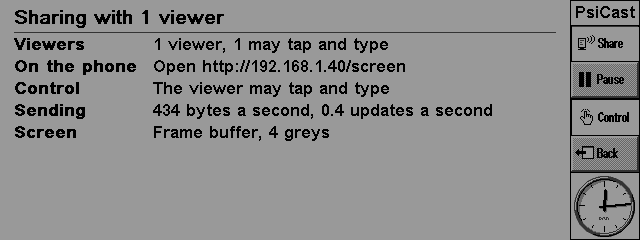
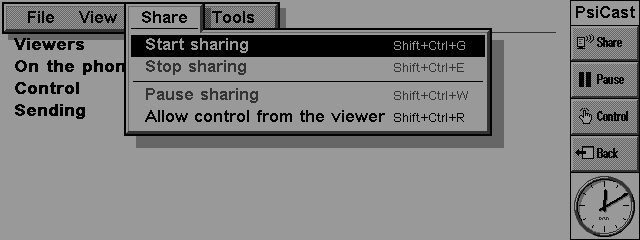
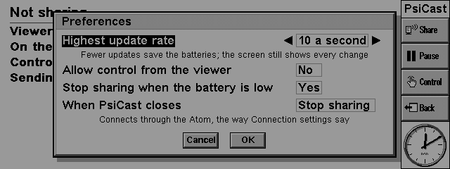

# PsiCast

Shows the **Psion Series 5mx**'s screen, live, in a web browser - on an iPhone, say - through the Atom modem, and if you want, lets the person watching tap and type on the Psion.

- The whole 640 x 240 screen in its 16 greys, as the Psion draws it: about ten updates a second while it changes, and a change after a still spell shows within about a tenth of a second.
- Watch only, as standard. **Allow control from the viewer** lets the viewer tap the screen and the icons round it, and type.
- **Pause** (Shift+Ctrl+W, in every program while sharing) stops sending before you type a password; the viewer keeps the last picture.
- It can go on sharing after PsiCast has closed, and stops by itself when the batteries are low.

**Status: alpha.** PsiCast runs in a 5mx emulator end to end, with a stand-in for the Atom (see *Testing*). It has not yet run on a real 5mx and Atom.

<p align="center"></p>

## What you need

- A Psion Series 5mx (EPOC R5).
- The **Atom modem** (`firmware/atom-modem`, an M5Stack Atom with the RS232 base) with its PsiCast firmware, connected to the Psion's serial port, and on the same Wi-Fi network as the phone.
- A phone or computer with a web browser. The first target is Safari on an iPhone.

## Using it

Install `dist/PsiCast.sis` (to D: if you have a CF card). PsiCast is on the Extras bar.

1. Tap **Share** on the toolbar (or press Shift+Ctrl+G). PsiCast connects to the Atom the way Tools > Connection settings says - the same settings as PsiTerm, PsiMail and PsiWeb - and says "Sharing the screen".
2. On the phone, open the Atom's address followed by `/screen`, for example `http://192.168.1.40/screen`. The Atom shows its address on its own screen; PsiCast shows it too once the Atom has said. The page asks for the Atom's web password.
3. Go to the program you want to show: tap **Back** (Shift+Ctrl+Y) to return to the one you used last.
4. To stop, tap **Share** again (or Shift+Ctrl+E).

| Key | |
|---|---|
| Shift+Ctrl+G, Shift+Ctrl+E | start, stop sharing |
| Shift+Ctrl+W | pause sharing, and go on again (works in every program while sharing) |
| Shift+Ctrl+R | allow control from the viewer, or not (it asks first) |
| Shift+Ctrl+Y | go to the previous program |
| Ctrl+K | Preferences |
| Ctrl+U | disconnect Psion Internet |
| Ctrl+M, Shift+Ctrl+M, Ctrl+T | zoom, show the toolbar |
| Shift+Ctrl+H, Shift+Ctrl+A | Help, About |

**Preferences** (Ctrl+K): the highest update rate (2, 5, 10 or 20 a second), allow control from the viewer, stop sharing when the battery is low, and what happens when PsiCast closes (stop sharing, or keep sharing until you open PsiCast again and stop it).

<p align="center">


</p>

### Control from the viewer

With control allowed, the viewer's taps and keys reach the Psion as if they were yours: taps on the screen and on the icons round it (Menu, the program icons, Extras), keys, and text typed on the phone. Text is turned into the 5mx's own keys (`@` is Fn+4, `£` Shift+3, and so on); characters the keyboard has no key for, such as accented letters, are left out. The viewer cannot switch the Psion off. While control is off, or sharing is paused, the viewer's input is ignored.

<p align="center"><br>What the viewer sees: text typed on the phone, in Data's Find box</p>

### Connection and power

- **Modem route:** PsiCast dials the Atom's own address (`ATDT192.168.7.1:5961`), and the serial port is PsiCast's while it shares: PsiTerm and the others can't use the modem meanwhile.
- **Psion Internet:** PsiCast connects to the Atom over the PPP link, which other programs can use at the same time.
- If the Atom doesn't answer, PsiCast tries again by itself, less often as time goes on. The line at the bottom of its screen says why.
- PsiCast reads the screen only while someone is watching and the Psion is on, and only glances at it when the screen is still: a quarter of the frame buffer ten times a second (about 1.5 ms each), nothing encoded or sent.

## How it works

PsiCast is two programs, like the others in the suite: `PsiCast.app`, the window and the settings, and `psicast.exe`, the engine, which runs only while sharing and talks to the app through a shared memory chunk (`engine/psicast.h`).

- **Reading the screen:** the engine reads the LCD frame buffer directly (`UserSvr::ScreenInfo`; the 32 bytes before it are the LCD palette, whose first entry gives the depth). The depth follows the program in front: the System screen is 4 greys (2 bits a pixel), 16-grey programs 4 bits. At start the engine compares the frame buffer with the window server's own copy of the screen (`CWsScreenDevice::CopyScreenToBitmap`), to be sure of the pixel order and polarity; if the frame buffer can't be read, that copy is the slower fallback.
- **Encoding:** `cast/codec` works out what changed (tiles, scrolling) and deflates it. The protocol to the Atom is in [`docs/PROTOCOL.md`](docs/PROTOCOL.md), the codec in [`docs/CODEC.md`](docs/CODEC.md). At most two updates are unacknowledged; changes made meanwhile are merged into the next, so the viewer always gets the newest picture, never a backlog.
- **Input:** `UserSvr::AddEvent`, the same raw events the digitiser and keyboard make, checked and rate-limited first.
- The log is `psicast.log` in PsiCast's folder (`psicast.old` the run before).

## Building

```
tools/docker/psibuild "cast/build.sh"      # dist/PsiCast.sis
```

`cast/build.sh` builds `psicast.exe` with `engine/engine.mk` and `PsiCast.app` with makmake in a project of its own, so its objects don't mix with the other programs' in the SDK's shared folders.

## Testing

Make a card with `node --experimental-strip-types tools/emu/mkcard.ts psicast`. The Atom's own firmware runs on a PC as `firmware/atom-modem/hosttest/hostmodem` (with `HOSTMODEM_CAST=1`; the viewer page is then at `http://127.0.0.1:5980/screen`), and the emulator's serial bridge can dial it like the real Atom.

`test/fakeatom.py` is a simpler stand-in for the Atom's end of the link: a Hayes modem on a unix socket (or a TCP port) that answers `ATDT192.168.7.1:5961`, decodes every update with the real codec, writes the screen as PNG, and can send the viewer's input from a script. With the emulator's serial bridge (`tools/emu/run.sh`, `EMU_SERIAL`):

```
python3 cast/test/fakeatom.py --unix /tmp/psicast/sock --out build/cast-atom \
    --control --answer-status --sim-clock --input taps.txt &
EMU_SERIAL=/tmp/psicast/sock tools/emu/run.sh cast \
    "50 22 40" "50.05 18 40" "50.2 71"          # Shift+Ctrl+G: start sharing
```

The decoded screens match the emulator's own screenshots pixel for pixel, at 4 and 16 greys. `--answer-status` and `--sim-clock` are for the emulator, which runs many times faster than real time while the Psion is idle.

## Credits

- **The 5mx's face** in the viewer's full screen (`firmware/atom-modem/src/cast/silk5mx.jpg`) is the 5mx skin of the Psion Web Emulator, with the screen area cut out: "Psion Web Emulator by Joe Haines — https://joehaines.com/psion".
- **The Series 7 theme's colours and pictures** come from the Psion Series 7's own ROM (EIKON's colour list, and the colour versions of the 5mx's icons, paired by `firmware/atom-modem/tools/s7icons.py`). They are Psion's.

## Support

PsiCast is free. If it's useful to you, see the Support section of the [main README](../README.md).
